<!-- ================= HEADER ================= -->

  

  
  
  

---

##  Về mình

- 🎓 Sinh viên năm 3 tại **Đại học Giao thông Vận tải TP.HCM**
- 🎯 Mục tiêu: trở thành **Backend Engineer**, đang tìm **Internship / Freelance**
- 🌱 Đang đào sâu: **kiến trúc hệ thống · tối ưu SQL · scaling · bảo mật · cloud**

 

---

 Tech Stack

  

---

## 

  

<!-- ================= FOOTER ================= -->

